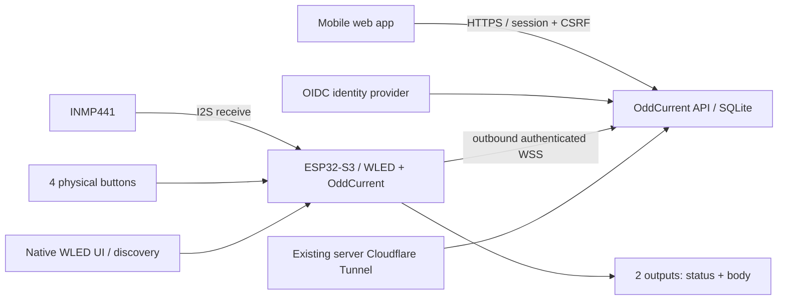

# Architecture decision 001 — local first, WLED adapter

Decision date: 2026-10-12. Status: selected for software implementation;
hardware acceptance pending. No hosted service or physical device is certified.

OddCurrent separates hardware profiles, device identity, coordinate maps,
firmware adapters, transport and account permissions. David is the first profile,
not a backend special case. The first command capability is `lighting`; motor
commands are absent and must require a separate physically fail-safe design.

## Firmware selection

Use upstream WLED **16.0.1**, revision
`29b389df1c1aaec6ff53aea742d17063b985906c`. Its N16R8 build target uses
QIO flash / OPI PSRAM, preserving the native UI, mDNS and audio-reactive usermod.
N16R8 alone does not establish the board carrier or USB wiring.

Build inspection found that WLED's default Tasmota Arduino 2.0.18 framework omits
the `WiFiClientSecure` library. OddCurrent selects WLED's documented alternative,
**espressif32 6.13.0 / Arduino 2.0.17 / IDF 4.4.7**, so the adapter can validate
public CA certificates. This is a build-level change, not a TLS bypass. Its extra
flash use and concurrent peripheral behaviour remain hardware acceptance gates.
Cloud connection work runs in a separate FreeRTOS task; WLED mutations and button
handling remain in the main loop with bounded message queues.

The owner revised David V1 to **two outputs** on 2026-10-12: status plus one
serial decorative chain (195 pixels provisional). This fits two of the four S3
RMT TX channels and leaves I2S0 for microphone input. The six-output capability
remains an alternative hardware profile; WLED's S3 parallel path uses the LCD
method, which still requires simultaneous bench validation. Source inspection
and compilation cannot prove concurrent electrical operation: that is a release
gate. Do not silently remove an output. If either selected path fails, compare an ESP-IDF
controller (better resource ownership, larger UI/effect rewrite) or a tested
clocked-pixel/multi-controller carrier in a new ADR before rewiring.

The OddCurrent usermod owns factory identity, cloud messages, four-button policy,
recovery and protected physical status overlay. Native WLED stays trusted-LAN
only. Never proxy its admin interface into the cloud. Signed OTA and tamper
resistance remain separate release gates; a compiled image is not a signed release.

## Backend and authentication

One FastAPI process serves static web assets, OIDC code + PKCE login, server-side
sessions and the device WebSocket. SQLite is sufficient for two gifts; one worker
is required because connected sockets are process-local. Scale with a shared
broker and database before adding workers. Device bearer credentials are random
per-device values; only SHA-256 hashes are stored centrally. Factory values
travel by reviewed serial tooling / private provisioning files, never in NFC.

Account identity is `(issuer, sub)`, not mutable email. An authenticated account
must additionally own a lamp or redeem a one-time claim code. Knowing its NFC URL
confers no write access. Explicit guest access is a device-scoped invitation with
expiry and curated commands. Ownership and advanced settings remain session-only.
Commands have an increasing persisted sequence, 10-second expiry and ID.
Reported state changes only on authenticated telemetry/acknowledgement. Offline
commands are rejected, never queued for later execution. Audio data never leaves
the MCU. Logs are structured events without raw payloads or secrets.

## Deployment boundary

Use the discovered existing server, reverse proxy, OIDC and server-side tunnel.
Portable templates use `example.invalid`; actual endpoints and private operating
facts belong in the private documentation registry. No ESP32 tunnel software.
New workload secret scope, exact issuer/client/callback, hostname routing and
capacity must be established before production activation. Do not alter unrelated
services or inherit their secret grants. Local loopback demo is explicitly a
simulator and cannot be enabled in production configuration.

## Sources inspected

- [Pinned WLED release](https://github.com/wled/WLED/releases/tag/v16.0.1)
- [WLED multi-strip support](https://kno.wled.ge/features/multi-strip/)
- [ESP32-S3 RMT](https://docs.espressif.com/projects/esp-idf/en/v4.4.6/esp32s3/api-reference/peripherals/rmt.html)
- [Espressif hardware design guidelines](https://documentation.espressif.com/esp-hardware-design-guidelines/en/latest/esp32s3/index.html)
- [INMP441 manufacturer datasheet](https://www.invensense.tdk.com/en-us/download-resource/ds-inmp441-00-inmp441-datasheet)
- [TI AHCT245 datasheet](https://www.ti.com/lit/ds/symlink/sn74ahct245.pdf)
