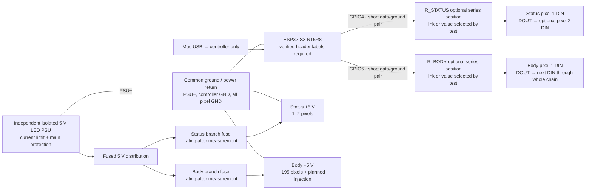

# David V1 practical wiring — direct GPIO

Owner decision, 12 October 2026: **two outputs, direct 3.3 V GPIO signalling,
no active logic-level translator**. GPIO4 drives the 1–2 status pixels; GPIO5
drives one approximately 195-pixel body chain. The logic-level margin is an
explicitly accepted engineering trade-off. Qualification of the actual pixel lot
and final harness is still required before either lamp ships.

This is the prototype connection plan, not carrier power/backfeed sign-off.
The [prototype plan](prototype-testing.md) defines the remaining checks.

## USB-only controller bench topology

The diagram's separate power and data boxes refer to the same two pixel chains.
**There is no LED +5 V connection to the controller in this bench topology.**
Power each chain through the protected distribution; its data wire carries no
LED supply current. Keep heavy LED returns out of controller/USB ground leads.
Run each short controller-to-first-pixel data connection alongside a ground
reference, with the controller and first pixel grounds held at the same potential.
Record the actual length rather than assuming a universal maximum.

| Net | Connection | Build note |
|---|---|---|
| STATUS_DATA | GPIO4 → optional R_STATUS → status pixel 1 DIN | 3.3 V direct drive; no translator |
| BODY_DATA | GPIO5 → optional R_BODY → body pixel 1 DIN | 3.3 V direct drive; no translator |
| STATUS_CHAIN | status pixel 1 DOUT → pixel 2 DIN if fitted | Confirm count as 1 or 2 |
| BODY_CHAIN | each body DOUT → next body DIN | One continuous serial data chain; no parallel data branches |
| LED_5V_STATUS | isolated PSU +5 V → protected status branch → status +5 V | Fuse protects selected wire/connectors |
| LED_5V_BODY | isolated PSU +5 V → protected body/injection branches → body +5 V | Each separately routed injection feed protected near distribution |
| COMMON_GND | PSU−, controller GND, both pixel chains and injection returns | Dedicated heavy LED returns to distribution; short local data reference |

Place the two optional series positions near the controller. Start with recorded
link/omitted values and compare resistor candidates against actual waveform and
error results. Optional DIN-to-ground pulldowns are initially unpopulated; add
only if reset/floating-input measurements justify them, then repeat qualification.
Their load must be included in the measured high-level margin. Do not pull the
ESP32 data pins up to 5 V. No resistor or pulldown value is approved by this plan.

## Controller power in the finished base — still pending

The production controller supply connection cannot be fixed until the carrier's
5 V input path, regulator capacity, both USB connectors and backfeed behaviour
are identified. Keep LED power independent of the controller's supply path.
Do not feed LED current through the carrier or USB. Do not join an external
+5 V controller feed to USB +5 V until the power-path checks establish a safe
arrangement. Use a documented single-source service arrangement or verified
power isolation when USB programming is needed. This outstanding power decision
does not reopen the accepted direct-data-drive decision.

Use an external isolated low-voltage supply, protected distribution, keyed
connectors and strain relief; no mains inside David. Select PSU, fuses, conductor
size, injection positions and any rail capacitance from measured loads and
voltage/transient tests. Firmware current limiting supplements physical protection.

## Microphone and buttons

Connect only after carrier labels and 3.3 V rail capacity have been checked.

| Peripheral | Controller connection |
|---|---|
| INMP441 VDD / GND | 3.3 V / common GND; local decoupling; never LED +5 V |
| INMP441 SCK/BCLK / WS / SD/DOUT | GPIO10 / GPIO11 / GPIO12 |
| INMP441 L/R | GND, subject to actual breakout pin identification |
| Power / scene / audio button | GPIO13 / GPIO14 / GPIO15, each momentary to GND |
| Recessed service button | GPIO16, momentary to GND; label and recovery access checked |

GPIO13–16 use input pullups in the extension. Keep switch and microphone wiring
away from heavy LED supply loops. Anatomical zones and XY coordinates are logical
maps of the body chain, not extra outputs. Protected status remains physical bus0
on GPIO4 and is excluded from decorative maps. While on, these pixels mirror
the first two final body pixels; standby alternates blue/violet breaths, and a
device fault takes priority with red. This changes firmware behaviour only.

## Accepted margin and change control

The actual seed driver revision and its input thresholds are not yet matched to
a datasheet. Nominal 3.3 V signalling into 5 V pixels is therefore accepted for
David V1 without claiming a manufacturer-guaranteed logic margin for this lot.
Measure DIN relative to the first pixel's ground and compare against the matched
input specification when available; record supply drop, ground offset and noise.
Successful operation elsewhere is experience supporting the owner decision;
shipment acceptance comes from repeatable results on both finished lamps.

Do not add a translator to the BOM, diagram or build by default. Do not repeatedly
ask the owner to reconsider. If an actual fault is reproduced, retain waveform,
pattern, wiring, supply and firmware evidence; distinguish signal faults from
power, timing, mapping or software faults. Propose corrective options based on
that evidence (routing/grounding/length, tested passive values, timing/configuration
or another justified change). Obtain an owner decision before changing the chosen
architecture.
